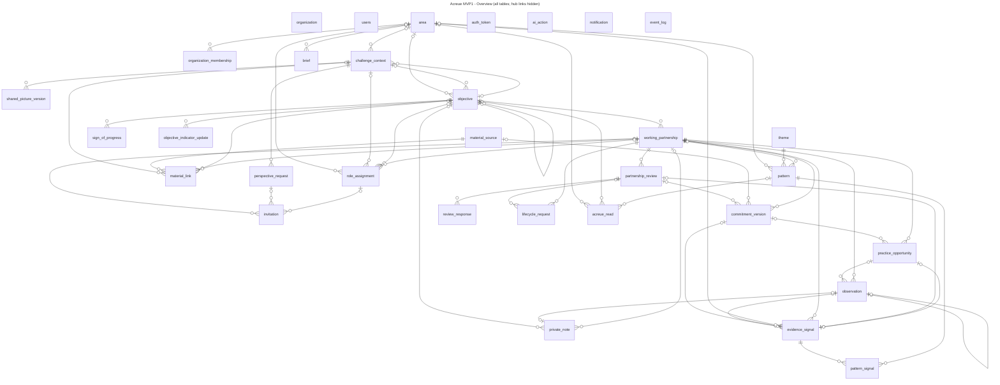
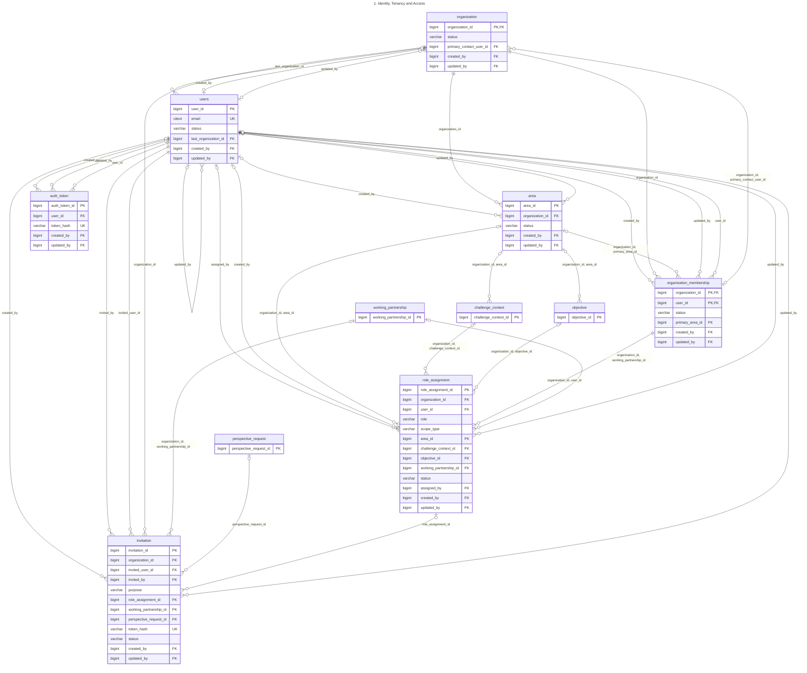
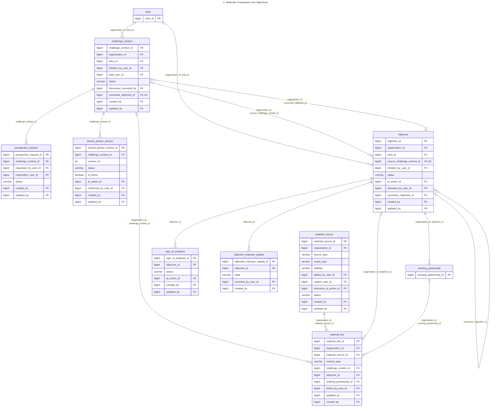
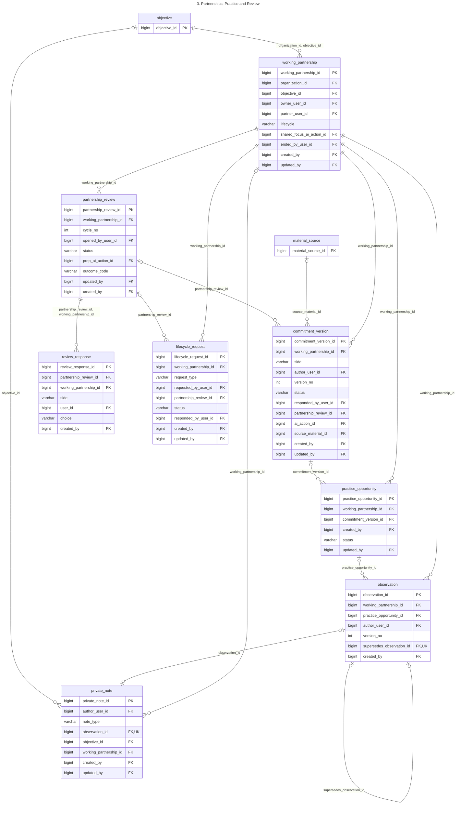
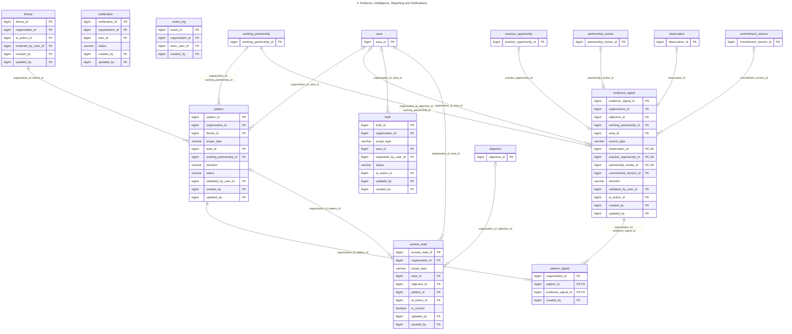

# Acreue MVP1 - ER Diagrams

Generated from [schema.sql](schema.sql). The full column list, constraints, indexes and triggers
are in [Acreue_Data_Model.xlsx](Acreue_Data_Model.xlsx). PNG/SVG copies are in this folder.

**Reading the diagrams**
- `PK` primary key, `FK` foreign key, `UK` unique. Only keys and state columns are shown per table.
- Crow's foot: `||--o{` one-to-many, `||--o|` one-to-zero-or-one, `|o--` optional parent (nullable FK).
- Key-only boxes are tables owned by another diagram, shown for context.
- Links to the hub tables `organization`, `users`, `organization_membership` and `ai_action` appear
  only in diagram 1, because almost every table references them.

## Full ER Diagram (all tables, all columns; created_by / updated_by links to users not drawn)

Every table, every column and every foreign key except the audit columns created_by / updated_by (each is an FK to users, shown as FK in the box but not drawn). Open er_full.svg or er_full.pdf and zoom in.

```mermaid
---
title: Acreue MVP1 - Full ER Diagram (all tables, all columns; created_by / updated_by links to users not drawn)
---
erDiagram
    organization {
        bigint organization_id PK,FK
        varchar name
        varchar default_timezone
        varchar status
        jsonb settings
        bigint primary_contact_user_id FK
        timestamptz created_at
        bigint created_by FK
        timestamptz updated_at
        bigint updated_by FK
    }
    users {
        bigint user_id PK
        citext email UK
        varchar display_name
        varchar timezone
        varchar password_hash
        varchar status
        boolean is_super_admin
        bigint last_organization_id FK
        jsonb last_context
        timestamptz last_login_at
        smallint failed_login_count
        timestamptz locked_until
        timestamptz password_changed_at
        timestamptz created_at
        bigint created_by FK
        timestamptz updated_at
        bigint updated_by FK
    }
    area {
        bigint area_id PK
        bigint organization_id FK
        varchar name
        varchar status
        timestamptz archived_at
        bigint created_by FK
        timestamptz created_at
        timestamptz updated_at
        bigint updated_by FK
    }
    organization_membership {
        bigint organization_id PK,FK
        bigint user_id PK,FK
        varchar status
        bigint primary_area_id FK
        varchar job_title
        boolean can_create_objectives
        timestamptz joined_at
        timestamptz deactivated_at
        timestamptz created_at
        bigint created_by FK
        timestamptz updated_at
        bigint updated_by FK
    }
    auth_token {
        bigint auth_token_id PK
        bigint user_id FK
        varchar token_type
        varchar token_hash UK
        timestamptz expires_at
        timestamptz consumed_at
        timestamptz created_at
        bigint created_by FK
        timestamptz updated_at
        bigint updated_by FK
    }
    role_assignment {
        bigint role_assignment_id PK
        bigint organization_id FK
        bigint user_id FK
        varchar role
        boolean is_manager_coach
        varchar scope_type
        bigint area_id FK
        bigint challenge_context_id FK
        bigint objective_id FK
        bigint working_partnership_id FK
        varchar status
        bigint assigned_by FK
        timestamptz started_at
        timestamptz ended_at
        varchar end_reason
        timestamptz created_at
        bigint created_by FK
        timestamptz updated_at
        bigint updated_by FK
    }
    invitation {
        bigint invitation_id PK
        bigint organization_id FK
        bigint invited_user_id FK
        citext sent_to_email
        bigint invited_by FK
        varchar purpose
        varchar personal_message
        bigint role_assignment_id FK
        bigint working_partnership_id FK
        bigint perspective_request_id FK
        varchar token_hash UK
        varchar status
        timestamptz expires_at
        int send_count
        timestamptz last_sent_at
        timestamptz responded_at
        timestamptz created_at
        bigint created_by FK
        timestamptz updated_at
        bigint updated_by FK
    }
    ai_action {
        bigint ai_action_id PK
        bigint organization_id FK
        varchar agent_code
        bigint requested_by_user_id FK
        varchar subject_type
        bigint subject_id
        jsonb input_refs
        varchar model
        varchar prompt_version
        varchar status
        jsonb output
        text error_message
        int latency_ms
        varchar decision
        bigint decided_by_user_id FK
        timestamptz decided_at
        timestamptz created_at
        bigint created_by FK
        timestamptz updated_at
        bigint updated_by FK
    }
    material_source {
        bigint material_source_id PK
        bigint organization_id FK
        varchar source_type
        varchar content_kind
        varchar scope_type
        varchar visibility
        varchar title
        varchar storage_key
        varchar url
        text body_text
        varchar file_name
        varchar mime_type
        bigint size_bytes
        char checksum_sha256
        varchar provider
        date meeting_date
        bigint added_by_user_id FK
        bigint subject_user_id FK
        text extracted_text
        jsonb relevance_statements
        bigint relevance_ai_action_id FK
        varchar extraction_status
        varchar status
        timestamptz created_at
        bigint created_by FK
        timestamptz updated_at
        bigint updated_by FK
    }
    material_link {
        bigint material_link_id PK
        bigint organization_id FK
        bigint material_source_id FK
        varchar context_type
        bigint challenge_context_id FK
        bigint objective_id FK
        bigint working_partnership_id FK
        boolean is_origin
        jsonb confirmed_statements
        bigint linked_by_user_id FK
        timestamptz linked_at
        timestamptz removed_at
        timestamptz updated_at
        bigint updated_by FK
        bigint created_by FK
    }
    challenge_context {
        bigint challenge_context_id PK
        bigint organization_id FK
        bigint area_id FK
        bigint initiated_by_user_id FK
        bigint lead_user_id FK
        varchar title
        varchar status
        text business_challenge
        text why_now
        text initial_evidence
        text affected_groups
        text value_if_improved
        jsonb gap_questions
        text discussion_agreed
        text discussion_different_views
        text discussion_most_important
        text discussion_participants
        bigint discussion_recorded_by FK
        varchar condition_room
        varchar condition_willingness
        varchar condition_support
        timestamptz conditions_checked_at
        boolean needs_attention
        text attention_note
        bigint converted_objective_id FK,UK
        timestamptz converted_at
        timestamptz created_at
        bigint created_by FK
        timestamptz updated_at
        bigint updated_by FK
    }
    perspective_request {
        bigint perspective_request_id PK
        bigint challenge_context_id FK
        bigint requested_by_user_id FK
        bigint respondent_user_id FK
        text prompt
        timestamptz due_at
        varchar status
        text response_text
        timestamptz submitted_at
        timestamptz cancelled_at
        timestamptz created_at
        bigint created_by FK
        timestamptz updated_at
        bigint updated_by FK
    }
    shared_picture_version {
        bigint shared_picture_version_id PK
        bigint challenge_context_id FK
        int version_no
        text content
        varchar status
        boolean is_active
        varchar generation_method
        bigint ai_action_id FK
        bigint confirmed_by_user_id FK
        timestamptz confirmed_at
        timestamptz created_at
        bigint created_by FK
        timestamptz updated_at
        bigint updated_by FK
    }
    objective {
        bigint objective_id PK
        bigint organization_id FK
        bigint area_id FK
        bigint source_challenge_context_id FK,UK
        bigint initiated_by_user_id FK
        varchar title
        text statement
        boolean is_priority
        varchar status
        varchar generation_method
        bigint ai_action_id FK
        timestamptz activated_at
        bigint activated_by_user_id FK
        timestamptz completed_at
        varchar close_outcome
        text close_what_moved
        text close_what_remains
        text close_what_learned
        text close_what_next
        bigint successor_objective_id FK
        timestamptz created_at
        bigint created_by FK
        timestamptz updated_at
        bigint updated_by FK
    }
    sign_of_progress {
        bigint sign_of_progress_id PK
        bigint objective_id FK
        varchar sign_text
        smallint sort_order
        varchar status
        varchar generation_method
        bigint ai_action_id FK
        bigint created_by FK
        timestamptz created_at
        timestamptz updated_at
        bigint updated_by FK
    }
    objective_indicator_update {
        bigint objective_indicator_update_id PK
        bigint objective_id FK
        varchar state
        text note
        bigint recorded_by_user_id FK
        timestamptz recorded_at
        bigint created_by FK
    }
    working_partnership {
        bigint working_partnership_id PK
        bigint organization_id FK
        bigint objective_id FK
        bigint owner_user_id FK
        bigint partner_user_id FK
        varchar lifecycle
        text relationship_context
        text shared_focus
        varchar shared_focus_method
        bigint shared_focus_ai_action_id FK
        text why_it_matters
        smallint review_cadence_days
        timestamptz invited_at
        timestamptz partner_accepted_at
        timestamptz partner_declined_at
        timestamptz owner_affirmed_at
        timestamptz activated_at
        timestamptz next_review_due_at
        timestamptz ended_at
        bigint ended_by_user_id FK
        varchar end_reason
        timestamptz created_at
        bigint created_by FK
        timestamptz updated_at
        bigint updated_by FK
    }
    commitment_version {
        bigint commitment_version_id PK
        bigint working_partnership_id FK
        varchar side
        bigint author_user_id FK
        int version_no
        text commitment_text
        text needs_from_other
        text revision_reason
        varchar status
        bigint responded_by_user_id FK
        timestamptz responded_at
        bigint partnership_review_id FK
        varchar generation_method
        bigint ai_action_id FK
        bigint source_material_id FK
        timestamptz created_at
        bigint created_by FK
        timestamptz updated_at
        bigint updated_by FK
    }
    practice_opportunity {
        bigint practice_opportunity_id PK
        bigint working_partnership_id FK
        bigint commitment_version_id FK
        bigint created_by FK
        varchar title
        text intent
        text involved_people
        timestamptz scheduled_at
        timestamptz ends_at
        varchar status
        timestamptz reflected_at
        timestamptz dismissed_at
        varchar calendar_event_ref
        timestamptz created_at
        timestamptz updated_at
        bigint updated_by FK
    }
    observation {
        bigint observation_id PK
        bigint working_partnership_id FK
        bigint practice_opportunity_id FK
        bigint author_user_id FK
        text tried
        text noticed
        varchar capture_method
        timestamptz observed_at
        int version_no
        bigint supersedes_observation_id FK,UK
        timestamptz created_at
        bigint created_by FK
    }
    private_note {
        bigint private_note_id PK
        bigint author_user_id FK
        varchar note_type
        bigint observation_id FK,UK
        bigint objective_id FK
        bigint working_partnership_id FK
        text body
        timestamptz created_at
        bigint created_by FK
        timestamptz updated_at
        bigint updated_by FK
    }
    evidence_signal {
        bigint evidence_signal_id PK
        bigint organization_id FK
        bigint objective_id FK
        bigint working_partnership_id FK
        bigint area_id FK
        varchar source_type
        bigint observation_id FK,UK
        bigint practice_opportunity_id FK,UK
        bigint partnership_review_id FK,UK
        bigint commitment_version_id FK
        varchar category
        varchar direction
        timestamptz evidence_at
        boolean eligible_for_rollup
        varchar extraction_method
        varchar validation_status
        bigint validated_by_user_id FK
        timestamptz validated_at
        bigint ai_action_id FK
        timestamptz created_at
        bigint created_by FK
        timestamptz updated_at
        bigint updated_by FK
    }
    partnership_review {
        bigint partnership_review_id PK
        bigint working_partnership_id FK
        int cycle_no
        timestamptz due_at
        bigint opened_by_user_id FK
        varchar status
        bigint prep_ai_action_id FK
        varchar outcome_code
        varchar agreed_choice
        timestamptz opened_at
        timestamptz completed_at
        timestamptz updated_at
        bigint updated_by FK
        bigint created_by FK
    }
    review_response {
        bigint review_response_id PK
        bigint partnership_review_id FK
        bigint working_partnership_id FK
        varchar side
        bigint user_id FK
        varchar choice
        text what_trying
        text what_happened
        text what_clearer
        text continue_or_change
        text try_next
        text notes
        timestamptz submitted_at
        bigint created_by FK
    }
    lifecycle_request {
        bigint lifecycle_request_id PK
        bigint working_partnership_id FK
        varchar request_type
        bigint requested_by_user_id FK
        text message
        bigint partnership_review_id FK
        varchar status
        bigint responded_by_user_id FK
        timestamptz responded_at
        text response_message
        timestamptz created_at
        bigint created_by FK
        timestamptz updated_at
        bigint updated_by FK
    }
    theme {
        bigint theme_id PK
        bigint organization_id FK
        varchar label
        varchar label_source
        bigint ai_action_id FK
        bigint renamed_by_user_id FK
        timestamptz created_at
        bigint created_by FK
        timestamptz updated_at
        bigint updated_by FK
    }
    pattern {
        bigint pattern_id PK
        bigint organization_id FK
        bigint theme_id FK
        varchar scope_type
        bigint area_id FK
        bigint working_partnership_id FK
        varchar evidence_strength
        varchar direction
        varchar status
        varchar trend
        varchar generation_method
        varchar validation_status
        bigint validated_by_user_id FK
        timestamptz first_evidence_at
        timestamptz last_evidence_at
        timestamptz created_at
        bigint created_by FK
        timestamptz updated_at
        bigint updated_by FK
    }
    pattern_signal {
        bigint organization_id FK
        bigint pattern_id PK,FK
        bigint evidence_signal_id PK,FK
        timestamptz added_at
        bigint created_by FK
    }
    acreue_read {
        bigint acreue_read_id PK
        bigint organization_id FK
        varchar scope_type
        bigint area_id FK
        bigint objective_id FK
        bigint pattern_id FK
        jsonb facts
        varchar headline
        text narrative
        text unclear_note
        varchar generation_method
        varchar validation_status
        bigint ai_action_id FK
        boolean is_current
        timestamptz generated_at
        timestamptz updated_at
        bigint updated_by FK
        bigint created_by FK
    }
    brief {
        bigint brief_id PK
        bigint organization_id FK
        varchar scope_type
        bigint area_id FK
        varchar title
        date period_start
        date period_end
        bigint requested_by_user_id FK
        jsonb snapshot
        text narrative
        varchar status
        bigint ai_action_id FK
        varchar validation_status
        varchar pdf_storage_key
        timestamptz generated_at
        timestamptz updated_at
        bigint updated_by FK
        bigint created_by FK
    }
    notification {
        bigint notification_id PK
        bigint organization_id FK
        bigint user_id FK
        varchar notification_type
        varchar subject_type
        bigint subject_id
        jsonb payload
        varchar dedupe_key
        varchar status
        varchar email_status
        timestamptz email_sent_at
        timestamptz read_at
        timestamptz resolved_at
        timestamptz created_at
        bigint created_by FK
        timestamptz updated_at
        bigint updated_by FK
    }
    event_log {
        bigint event_id PK
        bigint organization_id FK
        bigint actor_user_id FK
        varchar category
        varchar event_type
        varchar target_type
        bigint target_id
        varchar target_label
        jsonb context
        boolean is_support_access
        varchar support_reason
        inet ip_address
        timestamptz occurred_at
        bigint created_by FK
    }
    ai_action |o--o{ acreue_read : "ai_action_id"
    area |o--o{ acreue_read : "organization_id, area_id"
    organization ||--o{ acreue_read : "organization_id"
    objective |o--o{ acreue_read : "organization_id, objective_id"
    pattern |o--o{ acreue_read : "organization_id, pattern_id"
    users |o--o{ ai_action : "decided_by_user_id"
    organization ||--o{ ai_action : "organization_id"
    users |o--o{ ai_action : "requested_by_user_id"
    organization ||--o{ area : "organization_id"
    users ||--o{ auth_token : "user_id"
    ai_action |o--o{ brief : "ai_action_id"
    area |o--o{ brief : "organization_id, area_id"
    organization ||--o{ brief : "organization_id"
    users ||--o{ brief : "requested_by_user_id"
    users |o--o{ challenge_context : "discussion_recorded_by"
    area |o--o{ challenge_context : "organization_id, area_id"
    objective |o--o{ challenge_context : "organization_id, converted_objective_id"
    organization ||--o{ challenge_context : "organization_id"
    organization_membership ||--o{ challenge_context : "organization_id, initiated_by_user_id"
    organization_membership ||--o{ challenge_context : "organization_id, lead_user_id"
    ai_action |o--o{ commitment_version : "ai_action_id"
    users ||--o{ commitment_version : "author_user_id"
    partnership_review |o--o{ commitment_version : "partnership_review_id"
    users |o--o{ commitment_version : "responded_by_user_id"
    material_source |o--o{ commitment_version : "source_material_id"
    working_partnership ||--o{ commitment_version : "working_partnership_id"
    users |o--o{ event_log : "actor_user_id"
    organization |o--o{ event_log : "organization_id"
    ai_action |o--o{ evidence_signal : "ai_action_id"
    commitment_version |o--o{ evidence_signal : "commitment_version_id"
    observation |o--o| evidence_signal : "observation_id"
    area |o--o{ evidence_signal : "organization_id, area_id"
    working_partnership ||--o{ evidence_signal : "organization_id, objective_id, working_partnership_id"
    partnership_review |o--o| evidence_signal : "partnership_review_id"
    practice_opportunity |o--o| evidence_signal : "practice_opportunity_id"
    users |o--o{ evidence_signal : "validated_by_user_id"
    users ||--o{ invitation : "invited_by"
    users ||--o{ invitation : "invited_user_id"
    organization ||--o{ invitation : "organization_id"
    working_partnership |o--o{ invitation : "organization_id, working_partnership_id"
    perspective_request |o--o{ invitation : "perspective_request_id"
    role_assignment |o--o{ invitation : "role_assignment_id"
    partnership_review |o--o{ lifecycle_request : "partnership_review_id"
    users ||--o{ lifecycle_request : "requested_by_user_id"
    users |o--o{ lifecycle_request : "responded_by_user_id"
    working_partnership ||--o{ lifecycle_request : "working_partnership_id"
    users ||--o{ material_link : "linked_by_user_id"
    challenge_context |o--o{ material_link : "organization_id, challenge_context_id"
    material_source ||--o{ material_link : "organization_id, material_source_id"
    objective |o--o{ material_link : "organization_id, objective_id"
    working_partnership |o--o{ material_link : "organization_id, working_partnership_id"
    organization_membership ||--o{ material_source : "organization_id, added_by_user_id"
    organization ||--o{ material_source : "organization_id"
    ai_action |o--o{ material_source : "relevance_ai_action_id"
    users |o--o{ material_source : "subject_user_id"
    organization_membership ||--o{ notification : "organization_id, user_id"
    users |o--o{ objective : "activated_by_user_id"
    ai_action |o--o{ objective : "ai_action_id"
    area |o--o{ objective : "organization_id, area_id"
    organization ||--o{ objective : "organization_id"
    organization_membership ||--o{ objective : "organization_id, initiated_by_user_id"
    challenge_context |o--o{ objective : "organization_id, source_challenge_context_id"
    objective |o--o{ objective : "successor_objective_id"
    objective ||--o{ objective_indicator_update : "objective_id"
    users ||--o{ objective_indicator_update : "recorded_by_user_id"
    users ||--o{ observation : "author_user_id"
    practice_opportunity |o--o{ observation : "practice_opportunity_id"
    observation |o--o| observation : "supersedes_observation_id"
    working_partnership ||--o{ observation : "working_partnership_id"
    organization_membership |o--o{ organization : "organization_id, primary_contact_user_id"
    organization ||--o{ organization_membership : "organization_id"
    area |o--o{ organization_membership : "organization_id, primary_area_id"
    users ||--o{ organization_membership : "user_id"
    users |o--o{ partnership_review : "opened_by_user_id"
    ai_action |o--o{ partnership_review : "prep_ai_action_id"
    working_partnership ||--o{ partnership_review : "working_partnership_id"
    area |o--o{ pattern : "organization_id, area_id"
    theme ||--o{ pattern : "organization_id, theme_id"
    working_partnership |o--o{ pattern : "organization_id, working_partnership_id"
    users |o--o{ pattern : "validated_by_user_id"
    evidence_signal ||--o{ pattern_signal : "organization_id, evidence_signal_id"
    pattern ||--o{ pattern_signal : "organization_id, pattern_id"
    challenge_context ||--o{ perspective_request : "challenge_context_id"
    users ||--o{ perspective_request : "requested_by_user_id"
    users ||--o{ perspective_request : "respondent_user_id"
    commitment_version |o--o{ practice_opportunity : "commitment_version_id"
    working_partnership ||--o{ practice_opportunity : "working_partnership_id"
    users ||--o{ private_note : "author_user_id"
    objective |o--o{ private_note : "objective_id"
    observation |o--o| private_note : "observation_id"
    working_partnership |o--o{ private_note : "working_partnership_id"
    partnership_review ||--o{ review_response : "partnership_review_id, working_partnership_id"
    users ||--o{ review_response : "user_id"
    users |o--o{ role_assignment : "assigned_by"
    area |o--o{ role_assignment : "organization_id, area_id"
    challenge_context |o--o{ role_assignment : "organization_id, challenge_context_id"
    objective |o--o{ role_assignment : "organization_id, objective_id"
    organization_membership ||--o{ role_assignment : "organization_id, user_id"
    working_partnership |o--o{ role_assignment : "organization_id, working_partnership_id"
    ai_action |o--o{ shared_picture_version : "ai_action_id"
    challenge_context ||--o{ shared_picture_version : "challenge_context_id"
    users |o--o{ shared_picture_version : "confirmed_by_user_id"
    ai_action |o--o{ sign_of_progress : "ai_action_id"
    objective ||--o{ sign_of_progress : "objective_id"
    ai_action |o--o{ theme : "ai_action_id"
    organization ||--o{ theme : "organization_id"
    users |o--o{ theme : "renamed_by_user_id"
    organization |o--o{ users : "last_organization_id"
    users |o--o{ working_partnership : "ended_by_user_id"
    objective ||--o{ working_partnership : "organization_id, objective_id"
    organization_membership ||--o{ working_partnership : "organization_id, owner_user_id"
    organization_membership ||--o{ working_partnership : "organization_id, partner_user_id"
    ai_action |o--o{ working_partnership : "shared_focus_ai_action_id"
```

## Overview (all tables; hub links hidden)

All 32 tables and how the domains connect. Links to organization, users, organization_membership and ai_action are hidden.



## 1. Identity, Tenancy and Access

Organizations, users, memberships, contextual roles, invitations and auth tokens.



## 2. Materials, Preparation and Objectives

Challenge context to shared picture to objective, with materials linked to each context.



## 3. Partnerships, Practice and Review

Working partnership, versioned commitments, practice, observations, private notes, reviews and pause/resume/finish requests.



## 4. Evidence, Intelligence, Reporting and Notifications

Evidence signals roll up into themes and patterns, which feed Acreue's Read and Briefs.


